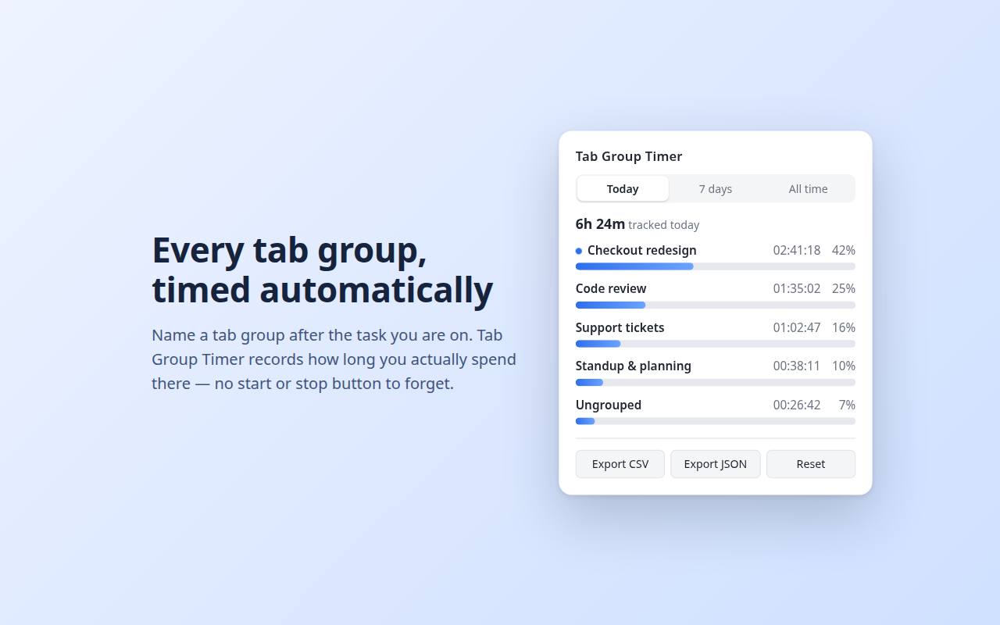
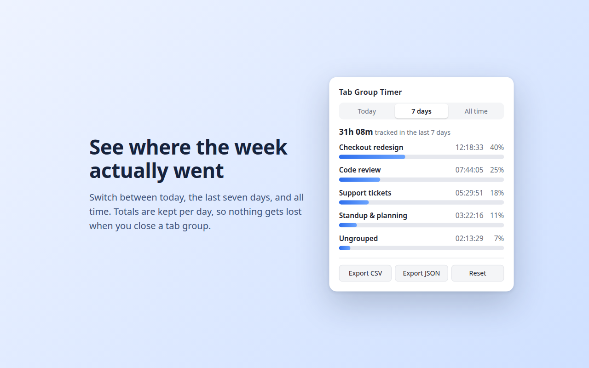

# ⏱️ Tab Group Timer

Where did my working hours actually go?

Name a Chrome tab group after the task you're on — `Checkout redesign`,
`Code review`, `Client A` — and this extension records how long you spend in it.
No timer to start, none to forget to stop.

**1 task = 1 group.**

---

## ✨ Features

- Tracks the active tab group automatically, with no manual start/stop.
- Pauses on idle, on lock, and when Chrome loses focus — away time isn't work time.
- Live counter for the group you're in right now.
- Today / last 7 days / all-time views, with per-day totals kept in history.
- Export to CSV or JSON.
- Delete a single group's history, or reset everything.
- No server, no account, no analytics. Everything stays in your browser.

---

## 📸 Screenshots





---

## 🛠️ Install from source

```bash
git clone https://github.com/<your-user>/tab-group-timer.git
cd tab-group-timer
npm install
npm run build
```

Then in Chrome:

1. Open `chrome://extensions`.
2. Enable **Developer mode** (top right).
3. Click **Load unpacked** and select the generated **`dist/`** folder.
4. Pin the extension to your toolbar and start working.

Requires Chrome 114 or newer.

---

## 🧪 Development

| Command               | What it does                                            |
| --------------------- | ------------------------------------------------------- |
| `npm run build`       | Bundles the extension into `dist/`                      |
| `npm test`            | Runs the test suite once                                |
| `npm run test:watch`  | Runs the tests in watch mode                            |
| `npm run typecheck`   | Type-checks `src/` and `test/`                          |
| `npm run verify`      | Typecheck + tests                                       |
| `npm run package`     | Verifies, builds, and zips `dist/` for the Web Store     |
| `npm run icons`       | Regenerates `img/icon*.png` (needs Python + Pillow)      |
| `npm run screenshots` | Regenerates the store screenshots (needs Google Chrome)  |

## 📂 Project structure

```
src/
  domain/          # Models, group identity, ports (Clock, TimeRepository, SessionStore)
  application/     # Use cases: tracking, checkpointing, pausing on blur
  infrastructure/  # Chrome adapters: storage, tab groups, clock
  popup/           # Popup UI and its pure summarisation logic
  shared/          # Message contract between popup and service worker
  manifest.json    # Copied into dist/ at build time
test/              # Vitest suites, mirroring src/
tools/             # Icon and screenshot generators
store/             # Chrome Web Store listing copy and assets
```

### Notes on the design

Two constraints shape the code:

- **The Manifest V3 service worker is killed after ~30s idle.** The in-progress
  interval therefore lives in `chrome.storage.session`, and a
  `chrome.alarms` heartbeat checkpoints it to disk once a minute. Nothing
  important is ever held only in worker memory.
- **Chrome recycles tab group ids across sessions.** History is keyed by a
  normalised group *title*, not by id, so a new group can never inherit an old
  one's tracked time.

## 🔒 Privacy

See [PRIVACY.md](PRIVACY.md). Short version: the extension does not request the
`tabs` permission, so it cannot read your URLs or page contents, and it makes no
network requests at all.

## 📄 License

[MIT](LICENSE).
